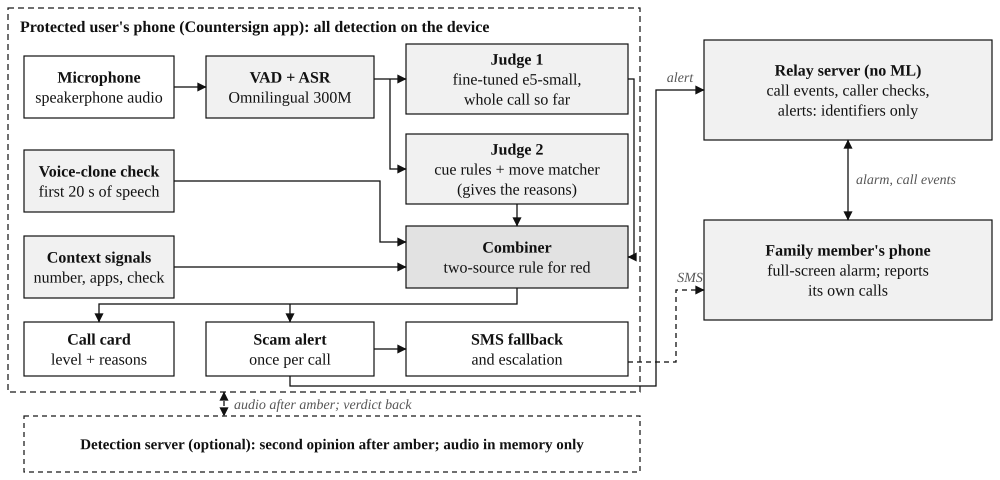
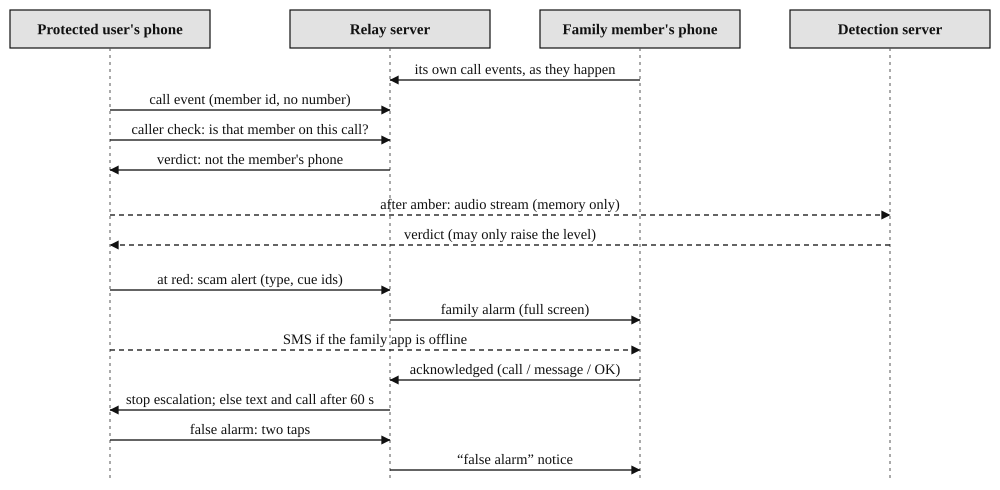
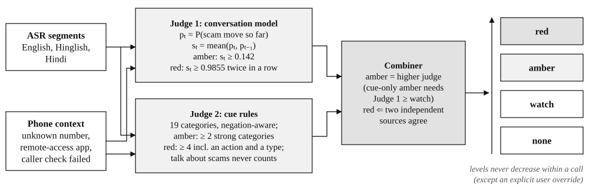

# Countersign: how it works, end to end

This is the whole system, from the moment a call rings to the alarm on a family member's phone. Each part says what
it does, where it lives in the code, the numbers it uses, and what data it keeps. Written against `main` at
`d6912dc` (25 Oct). The figures come from `docs/paper/figures.py`; the same system as a short paper for the jury:
[docs/paper/Countersign-paper.pdf](paper/Countersign-paper.pdf). Where something is designed but not built yet, it says so (see "Not built yet" at the end).

## The pieces at a glance

Three places run code:

| Where | What runs there | Code |
|---|---|---|
| **The phone** (every family member installs the app) | everything that hears or judges the call: speech-to-text, the conversation model, the cue rules, the voice-clone check, the context signals, the card, the alarm, the SMS | `android/app/src/main/java/app/countersign/bank/` |
| **The relay** (free host, Render) | passes messages between family phones: sign-up, family links, call events, caller checks, the scam alert, the family alarm. No models, no audio, no words | `engine/relay.py` (+ `engine/mobile.py`, `engine/callcheck.py`) |
| **The detection server** (a team laptop today; the bank's servers later) | the stronger check for calls the phone already finds suspicious, the evidence clip for confirmed scams, and the bank contact-centre path (Entry A) | `engine/app.py` |

The phone is the product. It works with no server at all for "Check a recording or message"; the relay is only needed
to reach family; the detection server is optional.

## 1. Before any call: setting up the phone

1. **Sign-up** (`ui/Onboarding.kt`, `POST /api/m/signup`): language (English or Hindi), name, mobile number, how
   family checks should reach this phone (ring or notify). The phone makes a key in the Android Keystore
   (`DeviceKey.kt`): the private half never leaves the phone's secure hardware and signs only after a fingerprint or
   screen-lock check; the server keeps the public half. The server returns a device token, sent in the
   `X-Device-Token` header on every request (never in a URL).
2. **Permissions**, one card each in plain words (`ui/Setup.kt`): phone state, call screening (to read who is calling),
   outgoing calls, notifications, display over other apps, app usage, full-screen alerts, battery, microphone, the
   **Call listener** (an accessibility service, `ListenService`), SMS, calling, do-not-disturb access.
3. **The model pack** (`ModelPack.kt`, `GET /api/m/models`): one download of 798 MB on Wi-Fi, checked against its
   sha256 (`ab299c53…`), unzipped into the app's private files. It holds:
   - the speech-to-text model (Meta's Omnilingual ASR 300M, int8) and Silero VAD;
   - the voice-clone model (`voice.int8.onnx`);
   - our fine-tuned conversation model (`conv.onnx`, fp32, 470 MB), and the base e5 model used by the move matcher
     (`e5base.int8.onnx`, 118 MB).

   Until it is installed, the phone runs **basic mode** (cue rules + our small classifier) and the Check screen asks
   for the download.
4. **Family** (`ui/FamilyScreens.kt`): Mummy shows a QR code, Rahul scans it and names her "Mummy", and Mummy accepts.
   Each phone now knows the others' member ids and numbers. A raw phone number never leaves the phone; matching is done
   on the phone by the last 10 digits (`FamilyNumbers.kt`). There is also a **work circle**: a boss or colleague who
   might ask for a payment.
5. **Always on** (`CallWatchService.kt`): a foreground service while signed in. It keeps the events socket
   (`/ws/events`) open, so family checks and alarms arrive at once, and it starts the listener, the card, the scam
   alert and the server stream.

## 2. A call rings

1. **Who is calling** (`CallScreener.kt`, `OutgoingCalls.kt`): the app holds the call-screening role only to read the
   number. Every call goes through untouched; the number goes to `FamilyNumbers` in memory and is matched to a family
   member, or nothing.
2. **Call events** (`CallWatchService`, `POST /api/m/call-event`): ringing, outgoing, answered, ended, and which member
   it matched. No number, no audio.
3. **The card appears** (`Overlay.kt`, `ui/overlay/CallCheckCard.kt`) at the top of the dialer while the call rings or
   is answered. It is not focusable, so the dialer keeps its buttons. It is an accessibility overlay when the Call
   listener is on, otherwise a "display over other apps" window. When the phone is locked, Android hides overlays, so
   the same content shows as a heads-up notification instead (`CallCheckNotice.kt`).

### 2a. "Is it really Rahul?" (the caller check)

If the number is a family member's, the check starts by itself. If an unknown caller says they're family, the card
has **"Says they're family? Check"**: Mummy taps Rahul's face.

The relay (`engine/callcheck.py`) then looks at **Rahul's own phone's call events** around the moment Mummy's phone
rang. No audio is used:

| What Rahul's phone reported | Verdict on Mummy's card |
|---|---|
| an outgoing call to Mummy | ✓ "Really Rahul" (only "Rahul's phone" if they linked under 24 h ago) |
| an outgoing call then, the other number unknown | "Rahul's phone" (likely) |
| on a call, but not with Mummy | "Rahul's phone is on another call." |
| no call, and his app was seen in the last 2 minutes | ✗ **"Not Rahul's phone"** ("Caller ID may be faked" if Mummy saw Rahul's number) |
| his app not seen for 2 minutes | "Couldn't check": "Rahul's phone hasn't been online lately." (never a false ✗) |

A negative verdict waits up to 6 s for late events before it is final. A call that started on Rahul's phone between
45 s before and 5 s after Mummy's ring counts as "this call". A cloned voice, a friend's phone and a spoofed caller ID
all fail the same way, because none of them makes Rahul's phone place the call.

Mummy can also tap **Ring Rahul**: his phone rings full screen and over the lock screen (`ApprovalActivity.kt`) and
asks "Is it you on Mummy's call?". "Yes" is signed by his phone's key after his fingerprint; "No" needs nothing, so
anyone holding his phone can stop it. The screen can't be captured (FLAG_SECURE), so a screen-sharing app can't watch
it. A ✗ or a "No" becomes the context signal `caller_check_failed` for the call, and turns on scam context for
Mummy's account (below).

## 3. Listening to the call (on the phone)

**On speaker only.** On the earpiece the mic mostly hears Mummy, not the caller. `ListenService` tells the card whether
the call is on speaker; the card says "Put on speaker so we can listen" until it is. Some phones' echo cancellation
also removes the caller from the mic on speaker (docs/RESULTS.md, failure 2).

1. **The mic** (`ListenService.kt`): an accessibility service, because Android lets one keep the microphone during a
   call, which ordinary apps can't. It records 16 kHz mono only while a call is on and the user has "Listen to my
   calls" on. Frames go to memory and are never written anywhere.
2. **Speech segments** (`Speech.kt`): Silero VAD (threshold 0.5, minimum silence 0.4 s, minimum speech 0.25 s, segments
   up to 12 s) cuts speech into segments. Each segment is decoded by the speech-to-text model(s) in the pack (sherpa-onnx,
   2 threads). The audio of each segment is then dropped. Only the text goes on.
3. **The voice-clone check** (`CallListener.kt`, `VoiceCheck.kt`): the first ~20 s of loud-enough audio (a rough
   speech gate) go once through the voice model (the first layers of NII's AntiDeepfake wav2vec-large, frozen, plus our
   own head, int8 ONNX). The score 0–1 becomes the signal `synthetic_voice` when it is at or above the model's
   threshold. It can lift a call from "a few warning signs" to amber, never to red, because over a speakerphone its
   error rate is high.
4. **What the phone sees** (`CallContext.kt`): context signals, which stay on for the rest of the call once seen
   (except the caller check's, where the latest answer wins):
   - `unknown_number` (not family or a contact) or `known_contact`;
   - `international_number` (an incoming number not starting +91 / 0091 / a plain 10 digits);
   - `video_call_unknown` (the camera became busy during an internet call);
   - `remote_app_opened` (AnyDesk, TeamViewer, QuickSupport, RustDesk, AirDroid, Splashtop came to the front);
   - `payment_app_opened` (GPay, PhonePe, Paytm and others);
   - `long_call` (over 15 minutes);
   - `caller_check_failed` / `caller_verified`.

   Two more are worked out from the words (`Hybrid.kt`, `derivedContext`):
   - `digits_read_out`: Mummy read out 4 to 8 digits on an unknown call, likely an OTP;
   - `bank_claim_not_1600`: the caller claims to be a bank or authority on an unknown number.

## 4. Judging the call: the two judges

Every new segment goes into one `Analyzer.Call` per call (`data/listen/Analyzer.kt`, pure Kotlin, the same code as
`engine/listener/analyzer.py` + `hybrid.py`; CI checks both give identical answers on shared test vectors).

### Judge 1: the conversation check (with the model pack)

`data/listen/Conversation.kt` (Python twin `engine/listener/conversation.py`).

- **The text it reads:** the call so far, newest words kept (left-truncated to 320 tokens), normalised, each script
  kept as it is (the model reads Devanagari natively), with the prefix "query: ". It is tokenised on the phone by our
  own SentencePiece tokenizer in Kotlin, identical to Hugging Face's (0 mismatches on 3,005 texts).
- **The model:** `intfloat/multilingual-e5-small` (118M parameters), fine-tuned by us with a logistic head on
  **ICFD-31k** (31,000 Indian bank-call conversations in English and Hinglish, scam and genuine; IJCAI 2026) plus our
  own sets. Our sets are weighted 8×, 1 epoch, trained on the team's RTX laptop. It gives **p**: how likely it is
  that the caller has made a scam move so far. It runs as fp32 ONNX on the phone with onnxruntime; int8 drifted up
  to 0.2 in p, so we ship fp32.
- **The accumulator** (`conv.json`), applied segment by segment:
  - p is smoothed over the last 2 segments;
  - **watch** at p ≥ 0.0102, **amber (warn)** at p ≥ 0.142, **red (scam)** needs p ≥ 0.9855 on **2 segments in a row**;
  - these thresholds were set on 1,788 genuine development calls, at 10% / 3% / 0.5% false positives;
  - from a known contact or a verified caller the bar is higher: 0.142 / 0.9865 / 0.9932;
  - `caller_check_failed` or `remote_app_opened` alone make amber;
  - red can also come from amber plus a strong phone signal (`remote_app_opened`, `caller_check_failed`,
    `video_call_unknown`, `international_number`);
  - a computer-made voice lifts watch to amber, never higher;
  - **levels never go down during a call** (except when the user says it isn't a scam).
- **The "why"** (the move matcher, `ml/moves.py`, `assets/moves.json`): each segment is embedded with the base e5
  model and compared with written descriptions of 17 scam moves, for example "says they're police", "threatens
  arrest", "asks to keep it secret", "asks for the OTP", "asks to install an app". Each move has its own threshold
  (the 99.5th percentile on genuine calls). A move is named only when p has risen by at least 0.15 or the level
  changed. It never decides the level; it only writes the reason.

### Judge 2: the cue rules (and, in basic mode, our small classifier)

`data/listen/ScamScorer.kt` + `Fusion.kt` (Python `engine/listener/rules.py` + `fusion.py`).

- **Cue rules** (`assets/scam_patterns.json`, 19 categories in English, Hinglish and Hindi):
  - the categories: authority, threat, secrecy, video_move, money_ask, credentials, remote_access, urgency,
    family_emergency, reward, verification_pretext, parcel_customs, sim_block, job_task, investment, boss_pretext,
    payment_redirect, victim_says, and discussion;
  - negations are handled ("we will never ask for your OTP" doesn't count as asking);
  - **discussion** (talk *about* scams) never counts towards red.
- **Scam types** come from which categories appear together. For example, `digital_arrest` = authority + one of
  threat / video / secrecy. The other types: courier_customs, trai_sim, remote_access, bank_kyc, family_emergency,
  investment, job_task, otp_upi, reward, boss_payment.
- **Fusion** (`assets/fusion.json`):
  - **watch** at 1 category;
  - **amber** at 2 strong categories, or a strong phone signal alone;
  - the cue rules' own **red** needs 4 categories including an action and a type, and no discussion;
  - a phone signal counts once: it never also counts as a cue towards that amber;
  - a known contact or a verified caller needs one more category.
- **Our small classifier** (`ScamClassifier.kt`, basic mode only): hashed character n-grams with logistic regression,
  in pure Kotlin. It abstains under about 25 words.

### The two together (`Hybrid.kt`, `combine`)

- **watch / amber** = the higher of the two judges. But cue words alone don't make amber while the conversation model
  hears nothing of a scam, because genuine bank and courier calls use the same words; a phone signal still does.
- **red** needs **two independent sources**, any one of:
  - the conversation model at red from the words, plus the cue rules at amber or above;
  - the cue rules at red from the words, plus the conversation model at amber or above;
  - a judge that already paired the words with a strong phone signal;
  - the user pressing **Alert family**;
  - the server's stronger check at red.
- The **scam type** shown is the conversation check's when it has one, otherwise the cue rules'.
- The **reasons** are the conversation moves first, then the cue categories, then the phone signals that count as
  evidence.
- **The level never goes down** during a call. The server can raise it, never lower it.

The result is the call's `Risk` (`CallRisk.kt`): level, scam type, reasons, and sources (conversation, cue rules,
voice, context, caller_check, server, user). It goes to `LiveCall.risk` in `RealRepository`, which every part below
watches.

## 5. What Mummy sees: the card

`ui/overlay/CallCheckCard.kt`, with words from `res/values/strings.xml` (English and Hindi):

| Level | The card |
|---|---|
| none | "Listening for scams" (or "Put on speaker so we can listen") |
| watch | still calm; a tip such as "If they rush you or say 'tell no one', hang up." |
| **amber** | a yellow card: the scam named ("This sounds like a 'digital arrest' scam."), one line of advice ("Police never ask for money on a call."), **"Why: says police, court or bank · asks you to keep it secret"**, an **Alert family** button, and an **I know this caller** link |
| **red** | a red card: **"This is likely a scam. Hang up."**, the why, "Family alerted", **Call Rahul**, and an **It's not a scam** link |
| cleared | "Cleared. Family told it's fine." |

A line under the card says what the phone is doing: "Watching this call closely.", "Double-checking this call on our
secure server.", "Your family has been alerted.", or "Payments are paused on this phone for now."

## 6. Amber: the stronger check (optional, the detection server)

`ListenStream.kt` → `/ws/listen` → `engine/listener/live.py`.

- It opens **only when the phone's own level reaches amber**, while the mic is recording, "Listen to my calls" is on,
  and the user hasn't said "not a scam". It closes when the call ends or is cleared.
- The phone streams 16 kHz audio plus its context signals. The server runs:
  - VAD, then Omnilingual ASR **1B** (larger than the phone's 300M model);
  - the same conversation check;
  - and on 4 s windows of speech, the full 24-layer AntiDeepfake voice model (S1). If the mean of the top 3 windows
    is at least 0.70, that adds `synthetic_voice`.
- It sends back `listen_verdict`, which goes into the phone's judges as the source `server`. It can raise, never lower.
- If the socket drops, the phone retries with a growing pause and carries on alone. If the stronger check is off for
  this account (4403), it stops for the call.
- **What the server keeps:** audio sits in a rolling 20 s buffer in memory and is dropped when the socket closes. Only
  if the call reaches red does the server keep that last 20 s as an **AES-256 encrypted evidence clip** in a fraud-desk
  case, deleted after 30 days or when the case closes. Transcripts are never stored; the case holds the tier, the scam
  type and cue ids.

## 7. Red: the alert goes out

`ScamAlert.kt`, once per call, the first time the call reaches red (from the judges, the server, or **Alert
family**):

1. **`POST /api/m/scam-alert`** to the relay with ids only: the call id, the level, the scam type, cue ids and
   sources. No words, no audio, no numbers. The relay (`callcheck.py`, `scam_alert`):
   - turns on **scam context** for Mummy's account (see 7b);
   - opens or extends a fraud-desk case;
   - for each family member, sends a `family_alarm` event on that phone's events socket if the app was seen in the
     last 2 minutes;
   - returns the offline ones in `text_these`.
2. **SMS fallback**: Mummy's phone texts, from her own SIM, the members whose app is offline, or everyone if the alert
   couldn't be sent. The message: "CS Bank: Mummy may be on a scam call right now. Please call them and tell them to
   cut the call. Don't let them send money or share an OTP." This needs the SMS permission and "Text my family if
   their app is off" on. Each member is texted at most once per call.
3. **Escalation**: if no family member acts on the alarm (Call / Message / OK) within **60 s**, her phone texts all of
   them and **calls the first one** (the first online member) from her phone, so a real person comes on the line. It
   stops the moment one acts.

### 7a. On Rahul's phone: the family alarm

`RealRepository.onEvent("family_alarm")` → `Notify.familyAlarm` → `FamilyAlarmActivity.kt` / `ui/FamilyAlarm.kt`:

- a notification on the "Family scam alarms" channel, full screen and over the lock screen (on Android 14+ only if
  full-screen alerts are allowed), and the alarm tone on a loop at full alarm volume. With do-not-disturb access the
  app switches do-not-disturb to "alarms only", so it rings through;
- the screen: **"Mummy may be on a scam call"**, the type ("It sounds like a 'digital arrest' scam."), "Just now",
  **Call Mummy**, and **Message Mummy** (an SMS, or WhatsApp if there's no SMS app). The message is pre-filled:
  "Mummy, cut that call now. It's a scam. Call me.";
- whichever he taps sends `family-alarm/ack`, which stops Mummy's phone escalating.

### 7b. Scam context on Mummy's own phone

The relay's `scam` state for her account (it also comes on after a ✗ caller check) lasts until **10 minutes after the
call ends**. While it's on:
- her Home screen shows a red banner telling her not to send money (after a caller check: "Careful: that caller
  wasn't Rahul. Don't send them money.");
- the call card shows "Payments are paused on this phone for now."

The full-screen red pay guard over GPay / PhonePe is designed but not shown yet (see "Not built yet").

## 8. A mistake costs two taps

- On amber, **I know this caller**; on red, **It's not a scam**. Both open "Is this call fine? We'll stop warning and
  tell your family it's fine." → **Yes, it's fine**.
- The phone clears the call: `CallRisk.clear()`, no more warnings this call, and the stronger-check stream closes.
- It sends `POST /api/m/scam-alert/clear` with the reason and ids only. The relay:
  - turns the scam context off;
  - sends `family_alarm_cleared` to the family who were alarmed. Rahul's alarm stops and he sees **"False alarm:
    Mummy says it's fine"**;
  - stores one ids-only feedback record for human review (`/api/metrics` counts them).

## 9. "Check a recording or message" (no call needed)

`ui/CheckScreen.kt` → `RealRepository.checkText` / `checkRecording` → `Analyzer.text`. All on the phone; nothing is
uploaded.

- **A message:** split at sentence ends into segments of up to 20 words, fed to the same two judges as a call. Then
  the whole text is judged once more by the conversation model; at p ≥ 0.9855 an amber becomes red, since a whole
  message is all the evidence there will be.
- **A recording** (any format Android plays, `AudioFile.kt`): decoded to 16 kHz in memory, then speech-to-text, the
  voice check and the same judges. The voice check's result counts as evidence (amber at most).
- **The result screen:**
  - "This is likely a scam" (red), "This looks like a scam" (amber), "A few warning signs" (watch) or "No signs of a
    scam";
  - the type and the why;
  - "The voice may be made by a computer" or "The voice sounds like a real person";
  - "What we heard" (the transcript, shown on screen only).
- **The same on a laptop:** `python -m ml.eval.kit <folder>` runs the Python twin and gives the same verdicts.

## 10. Privacy, all of it

| Data | Where it goes |
|---|---|
| call audio | phone memory only, dropped segment by segment; to the detection server only after amber, held in memory there; a 20 s AES-256 clip only for a confirmed scam, deleted after 30 days |
| the words (transcript) | phone memory only, for the length of the call; never stored, never sent (the server builds its own from the audio and doesn't store it either) |
| phone numbers | the phone only (matched to member ids by the last 10 digits); the family list's numbers are used for SMS and calls from the phone itself |
| what the relay gets | call events (member ids, not numbers), caller-check answers, the scam alert (level, type, cue ids, sources), "not a scam" (reason, ids) |
| logs | `adb logcat -s Listen CallListener CallRisk ScamAlert` shows levels, types and cue ids, never words or numbers |

## 11. The bank's contact-centre path (Entry A, the Round 1 engine)

For a bank's own call centre, on the detection server (`engine/app.py`, `engine/session.py`):

- **The call:** a caller calls the bank (`/ws/caller`, 8 kHz G.711 μ-law in 20 ms frames, from the browser page
  `/call` or the app's `BankCall.kt`; Amazon Connect ingest in `engine/ingest/connect.py`).
- **The signals**, every 2 s on the last 4 s window:
  - **S1** (`signals/s1_synth.py`): the synthetic-speech probability (AntiDeepfake W2V-Large / XLS-R + SLS);
  - **S2** (`s2_drift.py`): speaker drift inside the call (ECAPA embeddings);
  - **S3** (`s3_liveness.py`): a random liveness challenge read by the agent, with the reply's timing and words
    checked;
  - **S4** (`s4_context.py`): context, never audio; it can raise the tier one step, never lower it.
- **Fusion** (`engine/fusion.py`): a logistic score turns the signals into the tier GREEN / AMBER / RED, with plain
  reason codes.
- **Policy** (`engine/policy.yaml`, `policy.py`): tier × request risk → requirements, enforced on the server, so the
  agent console can't route around it. For example, changing the registered mobile at RED means no approval by phone:
  app approval, a 24 h cool-off, the fraud desk, and the customer alerted.
- **App approval** (`approvals.py`, `stepup/devicekeys.py`): the account holder's own phone rings with the request,
  and "Yes" is signed by the phone's key after a fingerprint.
- **Consoles:** `/agent` (the Voice Trust Card), `/fraud` (cases, reasons, the encrypted 20 s clip, every play logged;
  NCRP/1930 reporting in `cases.py`).

## 12. Hosting and keeping it awake

- **The relay** runs on Render's free tier (`render.yaml`, `Dockerfile.relay`) with Postgres. It sleeps when idle; the
  phone sends a wake-up ping and retries once patiently (#82), and a Cloudflare Worker on a schedule keeps it warm
  (#78). Before a demo, open `/health` once.
- **The detection server** runs on a team laptop (`uvicorn engine.app:app`), reached through a tunnel
  (`cloudflared`). Without it, everything else still works; the stronger check simply never runs.
- **Builds:** `./check.sh` / CI runs ruff, pytest (228 tests) and the Android build, lint and unit tests. The parity
  tests (Kotlin = Python on shared vectors: tokenizer, conversation, accumulator, hybrid, fusion, classifier) run in
  both.

## 13. How well it works (measured; every number in docs/RESULTS.md)

- **ICFD-31k held-out calls** (never trained on):
  - genuine calls wrongly flagged amber: 2.3% ("Clear Normal") and 4.5% ("Ambiguous");
  - genuine calls at red: 0.4% and 0.8%;
  - scam calls caught at amber: 87.8%.
- **Our 30-item spot-check kit:** 28/30.
- **20 fresh inputs** written on 25 Oct and never used to change anything: all 10 scams caught. The misses are talk
  *about* scams, and genuine calls read by a computer voice.
- **The hybrid on our sets:**
  - team calls: 93.8% of scams at amber, 7.7% of genuine calls;
  - adversarial rewrites: 75% at amber, 21.4% of genuine calls.
- **Named weaknesses:**
  - polite, scripted English scams;
  - talk about scams;
  - short calls rarely reaching red;
  - speech-to-text mistakes;
  - echo cancellation on some phones;
  - the voice check over a speakerphone.

## Not built yet (said plainly)

- **The full-screen pay guard** (`ui/overlay/PayGuardScreen.kt`: "Stop. This caller isn't Rahul." with Ring / Call /
  I understand) is designed but not shown by any service yet. Today, during scam context, opening a payment app adds
  the signal `payment_app_opened`, the card says "Payments are paused on this phone for now." and Home shows a red
  banner. Nothing appears over the payment app, and the app cannot actually stop a payment.
- **Signals in the contract that the phone doesn't produce yet:** `screen_share_started`, `unknown_video_long` and
  `series_1600`. The rules already know them.
- **The smarter check** (an on-phone LLM, Gemma through LiteRT-LM): the prompt and the parser are written and tested
  (`assets/llm_prompt.txt`, `Llm.kt`, `engine/listener/llm.py`), but there is no runtime on the phone, so it never
  runs.
- **The server's stronger check** runs the conversation check, not the hybrid, on its better audio. Its verdict joins
  the phone's hybrid as one more source.
- **Calls on the earpiece:** the phone hears mostly the owner, not the caller. The victim-side cues (`victim_says`)
  help a little, but on the earpiece the check is much weaker.
